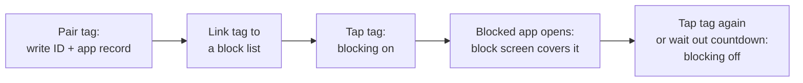

# 📵 NFC App Blocker

An Android app that blocks a chosen set of apps until you tap a paired NFC tag, so getting back to them takes a deliberate physical step.

## 🛠️ Dev setup

See [docs/Setup.md](docs/Setup.md) for prerequisites, building, installing and the adb debug helpers.

Background reading:

- [docs/IMPLEMENTATION_PLAN.md](docs/IMPLEMENTATION_PLAN.md): scope, phases and their status, testing strategy
- [docs/DECISIONS.md](docs/DECISIONS.md): decision log (D-001 and up). Accepted decisions are never edited; a new entry supersedes them.

## 📋 Table of Contents

- [Overview](#️-overview)
- [Project structure](#-project-structure)
- [Database](#️-database)
- [Configuration & Secrets](#-configuration--secrets)
- [Testing](#-testing)

## 🗺️ Overview

You pair NFC stickers with the app and group apps into block lists. Tapping a paired tag starts blocking its list; tapping it again stops blocking. While blocking is on, an accessibility service watches which app comes to the foreground and covers blocked apps with a block screen. Without the tag, a countdown (1–20 minutes, 3 by default) is the way out.



Notes:

- A tag holds a random UUID in a custom MIME record plus an Android Application Record, so a tap opens the app even when it is closed.
- Some apps can never be blocked: this app, the phone app, Settings, launchers, and a few essentials such as Maps.
- Built for personal use. Play Store publication isn't planned, but the design doesn't rule it out.
- UI in English and Dutch.

## 📁 Project structure

| Module | Responsibility |
|---|---|
| `:app` | The blocker app (`nl.nulldevelopment.nfcappblocker`, minSdk 30): tag pairing, block lists, the accessibility service, block screen, onboarding and settings. Kotlin, Jetpack Compose, Material 3, Hilt, Navigation 3, Room 3. |
| `:core:tag-format` | Pure Kotlin/JVM library defining the tag MIME type, payload and NDEF encoding. Shared by both apps so the format lives in one place. |
| `:hce-emulator` | Test app for a second phone that emulates an NFC Forum Type 4 tag over Host Card Emulation and serves our NDEF message. |
| `docs/` | Implementation plan, decision log and setup guide. |
| `third_party/` | License for the bundled Figtree font. |

## 🗄️ Database

`:app` stores its data in a local Room 3 (SQLite) database. Schema versions are exported to `app/schemas/` and upgrades use Room auto-migrations, which run when the app opens the database. Each migration has a device test.

| Table | Contents |
|---|---|
| `tags` | Paired tags: UUID, name, hardware UID and the linked block list |
| `profiles` | Block lists |
| `profile_apps` | Apps in each block list, by package name |
| `active_profiles` | The block list that is blocking right now |
| `block_sessions` | History of blocking sessions |
| `block_screen_views` | History of block screens shown |

## 🔐 Configuration & Secrets

The project has no secrets or external services. The only local config is `local.properties` with the Android SDK path, which Android Studio generates and git ignores.

## 🧪 Testing

Local unit tests use JUnit 5 (Jupiter, through `useJUnitPlatform()`), with MockK and Turbine where needed:

```bash
./gradlew :core:tag-format:test
```

```bash
./gradlew :app:testDebugUnitTest
```

```bash
./gradlew :hce-emulator:testDebugUnitTest
```

Lint:

```bash
./gradlew :app:lintDebug :hce-emulator:lintDebug
```

Device tests (Room migrations, DAOs, the installed-app source) use the AndroidX JUnit 4 runner and need a connected device or emulator. Don't run `connectedDebugAndroidTest` on a phone you use: it uninstalls the app afterwards, which deletes paired tags and block lists. Install both APKs and run the tests over adb instead:

```bash
./gradlew :app:installDebug :app:installDebugAndroidTest
```

```bash
adb shell am instrument -w nl.nulldevelopment.nfcappblocker.test/androidx.test.runner.AndroidJUnitRunner
```

NFC behaviour (tapping, cold launch, survival after reboot or long idle) is checked by hand on the reference device, a Samsung SM-S948B.
